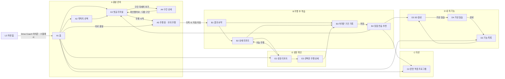

# Drive Coach 4.1 · 인터랙티브 목업

현대자동차그룹 차량용 앱 개발 공모전 제출용 목업이에요. 모든 주행 수치, 지도, 차량 정보는 **시뮬레이션 예시 데이터**예요.

> 함께 작업한다면 먼저 [AGENTS.md](AGENTS.md)(프로젝트 규칙)와 [CONTRIBUTING.md](CONTRIBUTING.md)(작업 절차)를 읽어 주세요.

## 프로젝트 개요

**Drive Coach**는 차량 인포테인먼트에서 돌아가는 **교육형 운전 보조 앱**이에요. 내비를 대신하지 않고 옆에서 돕는 역할로, 운전 전·중·후를 하나의 학습 루프로 묶어요.

| 축 | 흐름 |
| --- | --- |
| **운전 적응** | 첫길 리허설 → 주행 중 짧은 음성 코칭 → 운전 점수 리포트 → 어려운 구간 기록 → 다음 연습 추천 |
| **차량 기능 학습** | 기능 목록 → 3D 실내에서 버튼 위치 확인 → 가상 실습 → 기능별로 동의하면 주행 중 짧은 복습 |

**주요 사용자:** 처음 가는 길이 부담스러운 초보·장롱면허 운전자, 새 차의 기능이 낯선 신차 구매자

**설계 원칙**

- **내비가 먼저예요.** 음성 순서는 긴급·전화 → 내비 → 운전 코칭 → 기능 복습이고, 늦은 안내는 생략해요.
- **평가는 세 가지만 해요.** 급가속, 급감속, 제한속도 초과. 점수는 100점 만점의 교육용 지표이고 안전 인증이나 위반 판정이 아니에요.
- **주행 중 조작은 최소로 해요.** 지도 분석, 3D 조작, 동의 변경은 정차 중에만 할 수 있어요.
- **기록·코칭·기능 복습은 각각 켜고 꺼요.** 기능 복습은 기본이 꺼짐이고, 실습을 마치고 동의한 기능만 복습해요. 앱이 차량 기능을 대신 조작하지 않아요.
- **기록은 차량 안에만 저장해요.** 자동 클라우드 전송은 없어요.

**시연 시나리오:** 운전자 "지민" · 더 뉴 그랜저 2026 · 집 → 회사 출근길 12.4km(26분), 주요 구간 7곳. 이 중 시청 사거리 좌회전은 어려운 구간으로 표시돼 있어요. 같은 길 점수는 74 → 82 → 86 → 90(오늘)으로 올라가요.

## 목업 화면 플로우

화면은 18개예요. 주소 뒤의 해시(`#A3`)가 화면 ID이고, `` ` `` 키로 연 시연 패널에서 어느 화면으로든 바로 갈 수 있어요.



- **상단 탭**(모든 앱 화면 공통): 홈(A1) · 미션(C2) · 첫길 리허설(A3) · 리포트(E2) · 내 차(D2)
- **헤더 오른쪽:** 프로필(F2 운전자 프로필), 톱니바퀴(F4 설정 및 기록 관리)
- **하단 독:** Drive Coach 아이콘은 앱 홈(A1), 앱 모음 아이콘(■■)은 차량 홈(L0)

| 화면 | 이름 | 하는 일 |
| --- | --- | --- |
| L0 | 차량 홈 | 차량 런처. Drive Coach를 누르면 로딩 화면 뒤 A1로 들어가요 |
| A1 | 홈 | 오늘의 출근길, 브리핑 듣기, 리허설·출발 진입, 진행 상황 |
| A2 | 목적지 선택 | 다른 목적지 고르기 |
| A3 | 첫길 리허설 | 구간 7곳 타임라인. 누르면 지도에서 강조돼요 |
| A4 | 구간 상세 학습 | 교차로 애니메이션, 간단 3D 보기, 구간별 요령 |
| A5 | 주행 중 | 모의 주행 자동 재생. 내비 음성이 먼저 나오고 끝나면 코칭이 나와요. 도착하면 B1로 이동해요 |
| B1 | 주행 결과 요약 | 오늘 점수와 감점 요약 |
| B2 | 상세 운전 리포트 | 감점 위치와 시각 |
| B3 | 어려운 구간 기록 | 지도에서 지점을 고르고 이유를 골라 저장해요 |
| B4 | 맞춤 연습 추천 | 다시 리허설하기, 미션, 기능 학습 추천 |
| C2 | 운전 적응 프로그램 | 첫 출근길 적응·초보 운전·장롱면허 복귀·신차 적응 프로그램별 미션 진행 |
| D2 | 내 차 기능 목록 | 기능별 학습 상태 |
| D3 | 3D 실내 설명서 | 3D 운전석을 드래그하고 시점을 바꿔 버튼 위치를 확인해요 |
| D4 | 가상 실습 | 가상 버튼을 순서대로 누르고, 마치면 주행 중 복습에 동의할 수 있어요 |
| E2 | 성장 리포트 | 같은 길 / 전체 주행 점수 추이 |
| E3 | 선택한 주행 상세 | 지난 주행(11/8) 상세 |
| F2 | 운전자 프로필 | 프로필 선택(시연 데이터는 지민만 있어요) |
| F4 | 설정 및 기록 관리 | 기록·코칭·기능 복습 각각 켜고 끄기, 코칭 빈도, 음성 안내 순서 |

## 배포 (정적 호스팅)

빌드 과정이 없어요. 이 폴더를 그대로 올리면 돼요.

- **Netlify:** app.netlify.com/drop 에 폴더를 끌어다 놓기
- **GitHub Pages:** 저장소에 폴더 내용을 올리고 Settings › Pages에서 브랜치 지정
- **Vercel:** `npx vercel` (Framework: Other)

로컬에서 볼 때는 3D 화면 때문에 간단한 서버로 여세요.

```
cd drive-coach-mockup
python -m http.server 8000     # 또는 npx serve
# 브라우저에서 http://localhost:8000
```

`index.html`을 더블클릭해서(`file://`) 열면 화면 파일(`screens/`)을 불러오지 못해 빈 화면이 나와요. 꼭 위처럼 로컬 서버로 여세요.

## 녹화 팁

- **브라우저:** Chrome을 권장해요. 한국어 음성(TTS)이 가장 안정적이에요.
- **화면:** `F` 키로 전체 화면을 켜세요. 1280×720 화면이 창 크기에 맞춰 선명하게 확대돼요.
- **시연 패널:** `` ` `` (백틱) 키로 열고 닫아요. 녹화 전에 닫아 두세요.
  - 화면 바로가기
  - 모의 주행 재생 속도 (0.5x / 1x / 1.5x / 2x)
  - 음성 켜기/끄기, 운전 코칭 켜기/끄기
  - 크루즈 학습 완료 + 주행 중 복습 동의 (D 흐름을 거치지 않고 A5 크루즈 복습 장면을 바로 찍을 때)
- **단축키:** `Space` 모의 주행 일시정지, `R` 현재 화면 다시 시작
- **초기화:** 새로고침하면 처음 상태로 돌아가요.

## 시연 시나리오 예시 (기획서 6.3 기준)

0. **앱 실행 (L0 차량 홈):** 처음 열면 차량 홈 화면이 나와요. 하단 독의 Drive Coach 아이콘이나 Drive Coach 타일을 누르면 로고와 로딩 화면이 나온 뒤 홈으로 들어가요. 독의 앱 모음 아이콘(■■)을 누르면 다시 차량 홈으로 돌아가요.
1. **도입 (A1 홈):** [브리핑 듣기]로 코치 브리핑 음성 재생
2. **첫길 리허설 (A3 → A4):** 타임라인을 눌러 지도 강조 → [선택 구간 자세히 보기] → 교차로 애니메이션, [간단 3D] 전환 → [확인했어요 · 다음 구간]
3. **모의 주행 (A5):** [주행 시작]을 누르면 자동 재생
   - 내비 음성이 먼저 나오고, 끝난 뒤 코칭이 나와요.
   - 고속도로 구간에서 크루즈 복습 안내가 나와요 (학습 완료 + 동의한 경우만).
   - 도착하면 결과 화면(B1)으로 자동 이동해요.
4. **주행 결과 (B1 → B2):** 점수와 감점 위치 확인
5. **복습 (B3 → B4):** 지도에서 어려웠던 지점 선택, 이유 고르기 → 맞춤 연습 추천
6. **장롱면허 (C2 → E2):** 프로그램 전환, 동일 경로 / 전체 주행 비교
7. **신차 구매자 (D2 → D3 → D4):** 3D 실내 드래그, 시점 전환 → 가상 버튼 실습 → 주행 중 복습 켜기

## 폴더 구성

```
index.html          빈 스테이지 틀 + 실행(스플래시) 화면
screens/            화면 하나에 파일 하나 (L0 차량 홈 + 앱 화면 17개 A1~F4)
css/                화면 스타일 · 인터랙션 스타일
js/data.js          시나리오 데이터 (구간, 음성 대본, 미션, 차량 기능)
js/app.js           라우터 · 리허설 · 모의 주행 · 음성 · 실습 로직
js/three-scene.js   3D 실내 (Three.js, 대표 차종 단순 모델)
vendor/             Three.js r170 (MIT)
fonts/              Pretendard (SIL OFL 1.1)
assets/             차량·독 이미지 (팀 디자인 시안에서 발췌)
```

음성 대본이나 구간 설명은 `js/data.js`만 고치면 바뀌어요.
