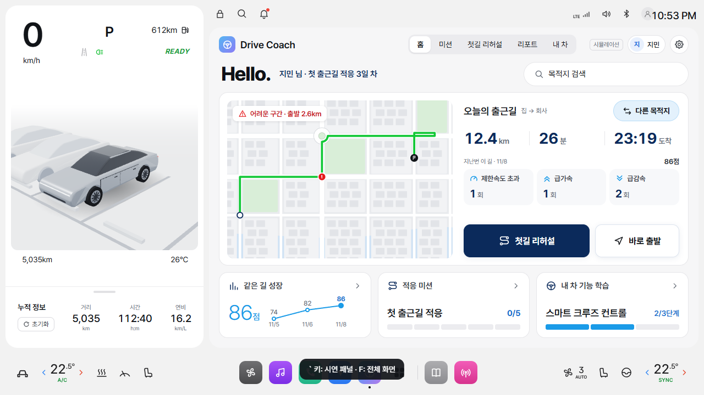
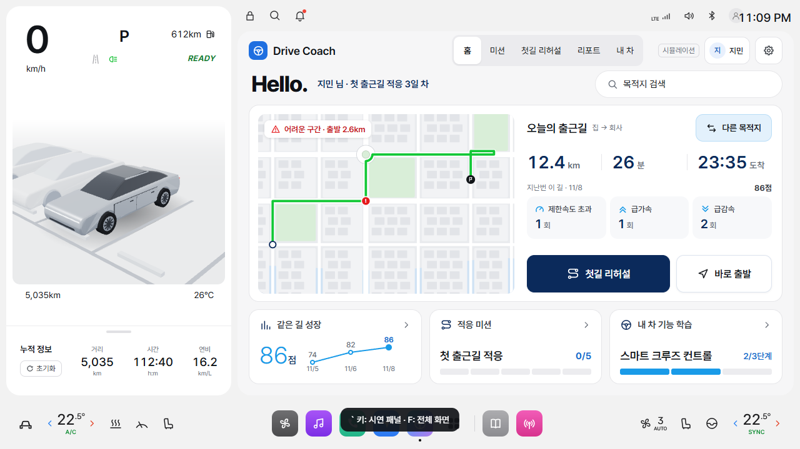
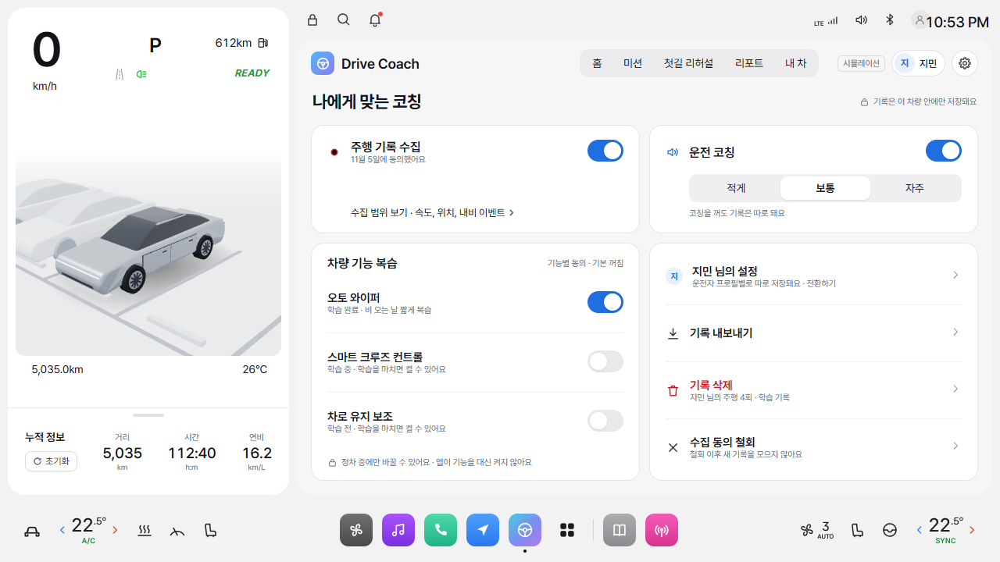
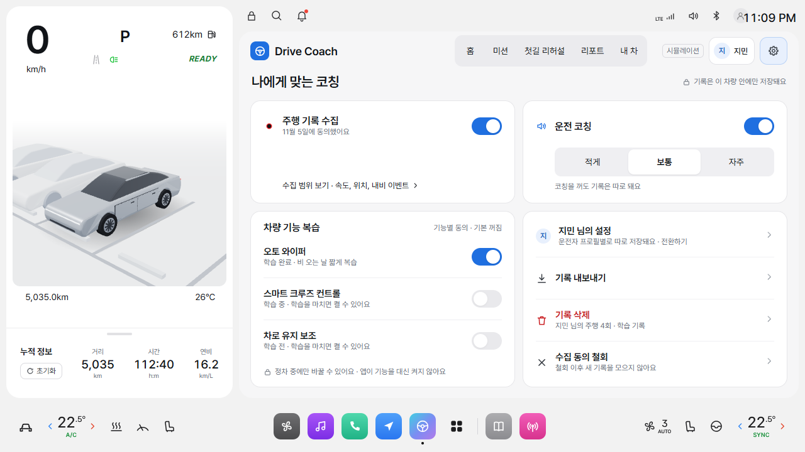

# Drive Coach UI 정리 기준과 검증

기존 1280×720 차량 틀과 화면 순서, 기능, 시나리오 값을 기준으로 접근성과 시각적 세부 사항을 정리한 변경이에요.

## 1. UI/UX Pro Max 기준

- 제품: 초보·복귀 운전자가 출발 전 연습하고, 운전 후 같은 길을 복습하는 차량용 목업이에요.
- 기본 테마: 확정된 라이트 테마, Pretendard Variable, 네이비 `#0B2A5B`, 파랑 `#1F6FE0`, A1의 하늘색 `#1A9BE8`을 사용해요.
- 정보 위계: 경로·코칭·점수는 분명하게, 헤더와 보조 정보는 조용하게 보여줘요. A1의 Hello.와 지도 중심 배치는 확정안으로 유지해요.
- 글자: 보조 글자는 기본 12px, 색 `#646B76`, 작은 글자의 자간은 0으로 맞춰요. 일반 글자는 대비 4.5:1 이상을 목표로 하고, 큰 글자와 의미 있는 그림은 역할에 맞게 구분해요.
- 조작: 헤더와 주요 버튼은 44px 높이, 설정 스위치는 실제 클릭 영역을 48×44px로 확보해요. 작은 지도 위치는 기존 확대 클릭 영역을 유지해요.
- 상태: 선택, 키보드 초점, 학습 전 비활성 상태를 각각 구분하고 접근성 속성도 같은 상태를 전달해요.
- 동작: 실제 주행·학습 상태는 유지하며, 동작 줄이기 설정에서 화면 전환·반복 강조 효과를 정지해요.
- 모서리: 기존 카드 16px, 버튼 12px, 칩 6px을 우선해요. 차량 틀의 22px 모서리도 유지해요.

제품 전체 스타일 검색은 차량 홍보·어린이 교육용 결과로 연결돼 이 제품에 적합한 조합을 찾지 못했어요. 해당 추천은 저장하거나 적용하지 않고, 프로젝트 확정 기준과 Pro Max의 대비·키보드 초점·조작 영역·동작 줄이기 규칙을 적용했어요.

### 수정 전 확인

- 공통 헤더 탭 높이 30px, 프로필·설정 높이 34px
- F4 스위치 5개가 키보드 초점을 받지 못하고, 그중 3개에 접근성 이름이 없음
- 아바타 작은 글자 대비 약 4.15:1, A1 점수 단위 약 3.04:1
- D4의 다음 단계 설명 대비 약 2.64:1
- 선택 상태와 실제 접근성 속성이 맞지 않는 선택 버튼
- 동작 줄이기 설정에서도 반복 강조와 화면 진입 효과가 계속됨

## 2. Unslop 점검

Pro Max 구현 결과를 기준으로 가벼운 정리 모드로 점검해요. 제품 내용과 확정된 배치를 우선하고, 지적된 문제만 다듬어요.

### 방향

- 제품: 운전 준비와 같은 길 복습을 이어주는 교육형 코치
- 성격: 차분함, 명확함, 친근함
- 환경: 차량 계기판과 익숙해지는 출근길
- 집중: 실제 기능을 보여주는 경로 지도와 주행 리포트
- 고유 요소: 화면을 이어주는 초록 경로선

### 점검과 반영

| 순서 | 확인한 부분 | 반영 |
| --- | --- | --- |
| 간격 | A1 요약 카드의 9·10·14·18px 혼용, A5 코칭 바의 불균일한 여백 | 해당 컴포넌트를 4px 기준으로 정리 |
| 색 | 헤더·런처·스플래시의 청보라 그라데이션과 색 그림자 | 기존 운전대 기호는 유지하고 확정 파랑 단색, 중립 그림자로 정리 |
| 아이콘 | 선택 칩의 체크 아이콘이 나타날 때 폭이 바뀜 | 아이콘 자리를 유지해 선택 전후 배치 고정 |
| 문구 | 실습 완료 문구의 느낌표, 반복 발광을 전제로 한 안내 | 완료 사실과 표시된 버튼을 직접 안내 |
| 글자 | 작은 글자의 음수 자간, 실습 단계의 10px 숫자 | 작은 글자 자간 0, 단계 숫자 12px |
| 배치 | 차량 틀·지도·카드의 기존 정보 구조가 제품에 적합 | 섹션 순서와 화면 구조 유지 |
| 세부 상태 | 선택·초점·학습 전 비활성 상태의 구분 부족 | 접근성 상태 속성과 초점 표시 보강 |
| 시각 자료 | 경로 지도·점수 그래프·차량 그림이 이미 제품을 설명 | 새 장식 이미지 추가 없이 기존 자료 사용 |
| 동작 | 독의 반복 링, 조작부의 반복 발광, 스플래시 진행 막대의 너비 애니메이션 | 정적인 강조와 transform 진행 표시로 정리 |

실제 발화 중인 코칭의 맥동은 상태를 알려주는 기존 기능으로 유지했어요. 동작 줄이기 설정에서는 맥동도 정지해요. Hello. 문구, 차량 틀, 경로색, 감점색, 기능과 시나리오 값은 확정 기준을 우선했어요.

## 검증

- 수정 전 → Pro Max 적용 → Unslop 정리 후, 세 차례에 걸쳐 L0·A1·A2·A3·A4·A5·B1·B3·B4·C2·D2·D3·D4·E2·E3·F2·F4 전체 17개 화면을 렌더링하고 비교했어요.
- 기본 화면의 HTML 글자 대비 자동 검사에서 경고가 20건 → 0건으로 줄었어요. SVG 지도·그래프·아이콘·PNG 안의 모든 글자까지 접근성 적합성을 인증하는 검사는 아니에요.
- 15개 앱 화면의 공통 헤더 조작 영역이 44×44px 이상인지, 현재 위치의 접근성 속성이 맞는지 확인했어요.
- F4 스위치 5개의 이름·48×44px 영역·키보드 초점·Space/Enter 조작을 확인했어요. 학습 전 복습은 켜지지 않고, 기어 D에서 설정 변경이 차단되는 것도 확인했어요.
- 선택 칩을 토글해도 주변 칩의 위치·크기가 바뀌지 않고, 메모와 저장 버튼이 겹치지 않는지 확인했어요.
- 리포트 필터, 미션 선택 후 초점 유지, 기능 그림 보기 전환, 키보드 가상 실습 완료, 완료 후 복습 동의로 초점 이동을 확인했어요.
- 민수 프로필로 전환해 기록 없는 화면을 확인하고 지민으로 돌아왔어요.
- 키보드 검사 중 선택 링크의 합성 클릭이 화면 해시를 초기화하는 문제를 발견했어요. 취소 가능한 클릭 이벤트로 수정하고 같은 검사를 통과했어요.
- 동작 줄이기 설정에서 독의 링과 스플래시 애니메이션이 정지하고 화면 진입이 완료되는 것을 확인했어요.
- 1024×768, 1440×900, 375×812 창에서 고정 차량 스테이지가 창 밖으로 잘리지 않는지 확인했어요. 375px 확인은 축소 표시 점검이며, 차량 UI를 휴대전화용으로 재설계하거나 작은 화면 가독성을 보장한 것은 아니에요.
- Chrome의 Microsoft Heami 한국어 음성과 기능 복습을 켠 상태로 A5 처음부터 B1 자동 도착까지 재생했어요. 내비·코칭 재생 표시가 동시에 켜진 경우는 없었고, 최종 실행의 콘솔·페이지 오류는 0건이었어요.
- `node --check js/app.js`, `node --test tests/tts.test.cjs`의 기존 회귀 테스트 15개, `git diff --check`를 통과했어요.

### 검증의 제한

- 실제 차량 신호, 실제 차량 터치 디스플레이, Edge 자연 음성, 스크린리더의 실제 음성 출력은 확인하지 않았어요.
- 두 검증 브라우저를 동시에 초기화했을 때 로컬 서버의 일부 요청에 연결 거절이 있었어요. 최종 화면 검사와 전체 주행은 순서대로 실행해 오류 없이 마쳤어요. 로컬 서버의 동시 접속 처리는 이번 수정에 포함하지 않았어요.
- 기존 지도 마커의 확대 클릭 영역과 지도 경계에서 잡히는 범위 초과 값은 수정 전과 같고, 새 글자 넘침은 발견하지 못했어요.

## 변경 파일

| 파일 | 변경 |
| --- | --- |
| `css/screens.css` | 공통 색 변수, 글자 대비·크기·자간, 헤더 조작 영역, 스위치, 버튼·링크 규격 |
| `css/app.css` | 초점·현재 위치 표시, 간격·그림자·로고 배경 정리, 선택 칩 배치 고정, 동작 줄이기 |
| `js/app.js` | 선택·비활성 접근성 속성, 키보드 조작·초점 유지, 가상 실습 문구와 단계 표시 |
| `screens/A1.html` | 점수 단위 글자의 대비 |
| `screens/D4.html` | 복습 동의 스위치의 키보드 초점과 이름 |
| `screens/F4.html` | 설정 스위치의 키보드 초점·이름, 작은 아바타 글자 |
| `docs/ui-polish-review.md` | 확정 기준, 두 스킬의 적용 순서, 점검 내용과 검증 범위 |
| `docs/validation/ui-polish/` | A1 홈과 F4 설정의 수정 전후 검토 화면 |

작업 브랜치는 `feat/ui-polish-main`이고, PR의 병합 대상은 `main`이에요. TTS 수정 PR #25가 반영된 최신 `main`에서 디자인 변경만 분리했어요. 앞선 PR #26은 중간 브랜치에 병합됐으므로, 이 변경은 새 PR에서 검토해요. 실제 병합은 사용자가 진행해요.

### 수정 전후

| 화면 | 수정 전 | 수정 후 |
| --- | --- | --- |
| A1 홈 |  |  |
| F4 설정 |  |  |

## 참고

- UI/UX Pro Max: 로컬 UX 가이드의 color-contrast, focus-states, touch-target-size, reduced-motion 기준
- Unslop: Damir Sokolovsky ([@heydamir](https://x.com/heydamir)), CC BY 4.0. 기존 제품의 간격·색·글자·상태·동작을 점검하는 순서를 참고했어요.
